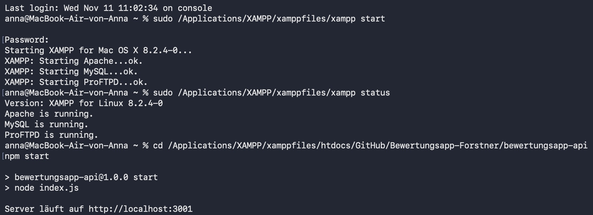

# Einheit 5 – Testbericht zur Bewertungsapp

**Testlauf am 11.11.2026:** 22 Requests und 44 automatische Prüfungen, keine Fehler. Ausgeführt mit Newman (Postmans Kommandozeilen-Runner) gegen den Express-Stand aus Commit `fa37f9b` und eine separate MariaDB-Testdatenbank mit den Projektmigrationen und den beiden Seedern. Nur für diesen Testlauf wurde `baseUrl` auf `http://localhost:13001` gesetzt. Das exportierbare Environment verwendet Port 3001.

Die Collection testet Team- und Projekt-CRUD, das Speichern einer Bewertung und den Durchschnitt pro Kriterium. Jeder Request prüft den Status automatisch. Bei JSON-Antworten wird zusätzlich die Antwortstruktur oder ein konkreter Wert geprüft; bei 204 muss der Antworttext leer sein.

| Test | Methode | Erwartet | Tatsächlich | Ergebnis |
|---|---|---:|---:|---|
| Team anlegen | POST | 201 | 201 | Bestanden |
| Teams auflisten | GET | 200 | 200 | Bestanden |
| Team abrufen | GET | 200 | 200 | Bestanden |
| Team ändern | PUT | 200 | 200 | Bestanden |
| Negativ: Klasse fehlt | POST | 400 | 400 | Bestanden |
| Negativ: ID ist Text | GET | 400 | 400 | Bestanden |
| Projekt anlegen | POST | 201 | 201 | Bestanden |
| Projekte auflisten | GET | 200 | 200 | Bestanden |
| Projekt mit Team abrufen | GET | 200 | 200 | Bestanden |
| Projekt ändern | PUT | 200 | 200 | Bestanden |
| Projekt löschen | DELETE | 204 | 204 | Bestanden |
| Negativ: Gelöschtes Projekt abrufen | GET | 404 | 404 | Bestanden |
| Testprojekt für Bewertungen anlegen | POST | 201 | 201 | Bestanden |
| Negativ: Pflichtfelder fehlen | POST | 400 | 400 | Bestanden |
| Bewertung für erstes Kriterium anlegen | POST | 201 | 201 | Bestanden |
| Negativ: Doppelte Bewertung | POST | 409 | 409 | Bestanden |
| Bewertung für zweites Kriterium anlegen | POST | 201 | 201 | Bestanden |
| Durchschnitt je Kriterium | GET | 200 | 200 | Bestanden |
| Negativ: Bewertetes Projekt löschen | DELETE | 409 | 409 | Bestanden |
| Unbenutztes Team anlegen | POST | 201 | 201 | Bestanden |
| Unbenutztes Team löschen | DELETE | 204 | 204 | Bestanden |
| Negativ: Gelöschtes Team abrufen | GET | 404 | 404 | Bestanden |

Die Auswertung lieferte tatsächlich:

```json
[
  {
    "criterionId": 1,
    "durchschnitt": "8.0000"
  },
  {
    "criterionId": 2,
    "durchschnitt": "6.0000"
  }
]
```

Das entspricht den erwarteten Werten 8 und 6 für die zwei Kriterien. Die Negativtests prüften zusätzlich zum Status, dass die API eine JSON-Fehlermeldung im Feld `error` zurückgibt.

## In Postman wiederholen

1. MySQL in XAMPP starten. Im Ordner `bewertungsapp-api` den API-Server mit `npm start` starten.

2. Collection und Environment als zwei JSON-Dateien importieren und `bewertungsapp-lokal` auswählen. Im Environment steht `baseUrl = http://localhost:3001`.
3. Das Environment erwartet den Demo-Juror mit ID 1 sowie die Kriterien Inhalt und Präsentationstechnik mit IDs 1 und 2. Falls deine lokale Datenbank andere IDs verwendet, passe `jurorId`, `criterionId` und `zweitesKriteriumId` im Environment an. In einer frischen Datenbank zuerst Migrationen und Seeder ausführen.
4. Die ganze Collection einmal in der vorgegebenen Reihenfolge ausführen. Die Tests stehen in Postman unter **Scripts → Post-response**. Die IDs der neu angelegten Teams und Projekte werden automatisch weitergereicht.

Der Lauf schreibt Testdaten. Das CRUD-Testprojekt und das Team für den Löschtest werden wieder gelöscht. Das Auswertungsprojekt, sein Team und seine zwei Bewertungen bleiben erhalten, da die API kein Löschen von Bewertungen anbietet. Am besten auf einer Testdatenbank ausführen.
